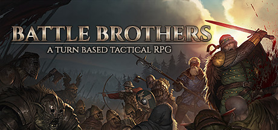

**Battle Brothers is a turn-based tactical RPG by Overhype Studios (2017).**

---

## 📖 About

Battle Brothers is a turn-based tactical RPG by Overhype Studios (2017). You lead a medieval mercenary company across a procedurally generated world, managing morale, injuries, and finances while fighting goblins, undead, and rival humans. Every brother can die permanently, making roster losses feel devastating.

## ⚠️ Problems Without Trainer

| Problem | Status |
|---------|--------|
| Permadeath wipes high-level brothers to unavoidable critical hits | ✅ Solved |
| Gold runs dry mid-campaign with no reliable income contracts | ✅ Solved |
| Morale system collapses entire rosters after a single bad engagement | ✅ Solved |
| Crafting and gear upgrading demands rare materials with low drop rates | ✅ Solved |
| Fatigue system makes long engagements punishing without stamina management | ✅ Solved |

## ✅ Solution

The **Battle Brothers Trainer** solves all these issues, giving you complete control so you can focus on enjoying the game.

## 🎯 Features

- Unlimited Resources / Currency
- God Mode / Invincibility
- Instant Skill & Ability Cooldown
- One-Hit Kill
- Freeze Timers
- Unlock All Items & Achievements
- Custom Speed Multiplier
- Infinite Stamina / Energy

## 🚀 Quick Start

1. **Disable Windows Defender** temporarily (trainer may trigger false positive)
2. Get the trainer from the button above
3. Launch Battle Brothers
4. Run the trainer as Administrator
5. Use the hotkeys to activate cheats in-game

## 💎 Free vs Pro

| Feature | Free | Pro |
|---------|------|-----|
| God Mode | ✅ | ✅ |
| Unlimited Resources | ✅ | ✅ |
| Advanced Cheats | ❌ | ✅ |
| Auto-Updates | ❌ | ✅ |
| Priority Support | ❌ | ✅ |

## 💻 Requirements

- Windows 10 / 11 (64-bit)
- Battle Brothers (any version)
- .NET Framework 4.8+
- DirectX 11+

## 🍎 macOS

## ⚖️ Legal

Educational and single-player use only.

---

